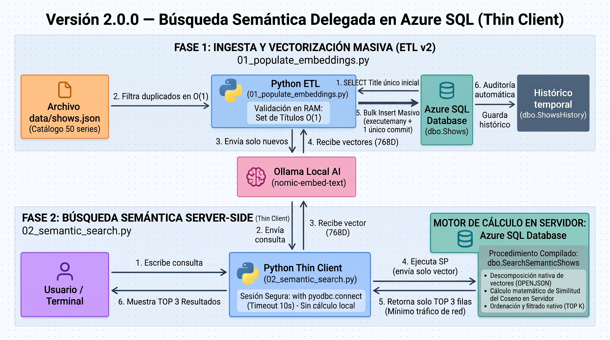

# 🎬 azureSQLSeries — Búsqueda Semántica de Series

Motor de recomendación y búsqueda semántica en lenguaje natural que conecta una base de datos relacional en la nube (**Azure SQL Database**) con procesamiento local de Inteligencia Artificial mediante **Ollama** (`nomic-embed-text`).

---

## 🏗️ Arquitectura del Sistema (v2.0.0 MVP)

En esta primera versión (MVP), la generación de vectores de texto se realiza localmente y el cálculo de la **Similitud del Coseno** se procesa en el lado del cliente (Python) sobre los datos almacenados en Azure SQL.



---

## 🛠️ Tecnologías Utilizadas

* **Lenguaje:** Python 3.10+
* **Base de Datos:** Azure SQL Database (Serverless)
* **Auditoría:** System-Versioning (`dbo.ShowsHistory`)
* **Modelo de IA:** Ollama — `nomic-embed-text` (Vectores de 768 dimensiones)
* **Librerías Python:** `pyodbc`, `requests`, `python-dotenv`
* **Conector DB:** ODBC Driver 18 for SQL Server

---

## ⚙️ Configuración del Entorno

### 1. Variables de Entorno (`.env`)
Crea un archivo `.env` en la raíz del proyecto (excluido en `.gitignore`):

```env
AZURE_SERVER=sql-server-sergio-dp800.database.windows.net
AZURE_DATABASE=TVShowDB
AZURE_USER=admiuser
AZURE_PASSWORD=TuContraseñaSegura
```

### 2. Instalación de Dependencias
```bash
pip install pyodbc requests python-dotenv
```

---

## 🚀 Ejecución del Proyecto

### Fase 1: Ingesta y Vectorización (ETL)
Extrae el catálogo desde `data/shows.json`, genera los embeddings con Ollama y los inserta en Azure SQL:
```bash
python scripts/01_populate_embeddings.py
```

### Fase 2: Buscador Semántico (CLI)
Genera el vector del prompt del usuario y busca las 3 series con mayor afinidad semántica:
```bash
python scripts/02_semantic_search.py
```

---

## 🗺️ Hoja de Ruta (Roadmap)

- [x] **v1.0.0 (MVP):** Pipeline ETL completo, auditoría temporal `System-Versioning` y cálculo de similitud vectorial client-side (Python).
- [ ] **v2.0.0 (Optimización DP-800):** Delegación del cálculo de Similitud del Coseno al motor de base de datos de Azure SQL mediante *Stored Procedures* en T-SQL.